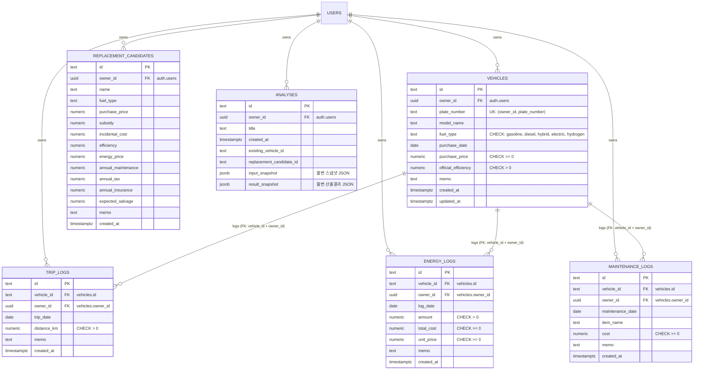

# Design: 화면 구성, 데이터 구조 및 계산 기준 (Supabase Cloud DB 적용)

## 1. 시스템 아키텍처 및 화면 구성

### 1.1 기술 스택 및 아키텍처 패턴
- **Frontend Core**: React 18 / TypeScript / Vite
- **Styling**: Tailwind CSS (Navy `#0F172A`/`#1E293B` 주조색, Teal `#0D9488`/`#14B8A6` 포인트 컬러, 밝은 배경 `#F8FAFC`)
- **Icons & Charts**: `lucide-react`, `recharts`
- **Cloud Database & Auth**: **Supabase (PostgreSQL 15+, Supabase Auth, Row Level Security)**
- **Architecture Pattern**: **Repository Pattern**
  - UI 컴포넌트는 `IFleetRepository` 인터페이스를 통해서만 데이터에 접근.
  - 현재 단계: `SupabaseFleetRepository`가 `@supabase/supabase-js`를 통해 PostgreSQL 클라우드 DB와 비동기 연동.
  - 클라우드 연결 오류 발생 시 오류를 숨기거나 로컬 저장소로 자동 전환하지 않고 화면에 명확한 원인(환경변수 미설정, RLS 거부, 테이블 부재 등)을 표시.
  - 기존 로컬 저장소 코드(`LocalStorageFleetRepository`)는 보존되어 데이터 유실을 방지.

```
[UI Layer (Pages & Components)]
         │
         ▼
[Auth Context (Supabase Auth: JWT Session)]
         │
         ▼
[Domain / Service Layer (Economics & Validation)]
         │
         ▼
[Repository Interface (IFleetRepository)]
    ├── SupabaseFleetRepository (현재 활성화: PostgreSQL Cloud DB + RLS)
    └── LocalStorageFleetRepository (보존: 독립 오프라인 구현체)
```

---

### 1.2 화면 레이아웃 및 5대 핵심 화면 구성

#### 레이아웃 공통 구조
- **상단 글로벌 헤더**:
  - 시스템 명칭: "기업 차량 운영 관리 및 친환경차 전환 경제성 분석 시스템"
  - **[Supabase DB: 연결됨]** / **[환경변수 미설정]** 클라우드 상태 뱃지
  - 로그인 상태 표시 (사용자 이메일, [시연 데이터 생성], [내 데이터 초기화], [로그아웃])
  - 미로그인 상태 시 [로그인 / 회원가입] 버튼 노출
- **환경변수 미설정 배너**:
  - `.env.local`이 없거나 `VITE_SUPABASE_URL`, `VITE_SUPABASE_ANON_KEY`가 미설정된 경우 최상단에 에러 배너를 명확히 노출하여 즉각 조치할 수 있도록 안내.
- **좌측 사이드바**: 대시보드, 차량 관리, 운행·비용 기록, 유지·교체 비교, 분석 이력.
- **사용자 데이터 격리 보장**:
  - 로그아웃이나 계정 전환 시 React 컴포넌트의 고유 Key(`user.id`)를 통해 화면 렌더링 상태를 즉각 클리어.

---

## 2. 데이터베이스 스키마 및 RLS 보안 설계

### 2.1 ERD 및 관계형 무결성
모든 테이블은 PostgreSQL의 `auth.users(id)`와 외래키(`owner_id`)로 연결되며, 특히 **운행(`trip_logs`), 주유·충전(`energy_logs`), 정비(`maintenance_logs`) 기록은 `(vehicle_id, owner_id)` 복합 외래키를 통해 자신의 차량에만 연결되도록 DB 레벨에서 원천 강제**합니다.



### 2.2 RLS(Row Level Security) 정책 정의
모든 테이블에 RLS를 활성화하고, Supabase의 JWT 인증 토큰(`auth.uid()`)과 테이블의 `owner_id`가 일치하는 행에 대해서만 DML을 허용합니다:

```sql
-- 예: vehicles RLS
CREATE POLICY "Users can manage their own vehicles"
    ON public.vehicles
    FOR ALL
    TO authenticated
    USING (auth.uid() = owner_id)
    WITH CHECK (auth.uid() = owner_id);
```

### 2.3 최소 권한 원칙(Least Privilege) 및 스냅샷 불변성 보장
- `anon`, `authenticated`의 기존 전체 권한을 6개 테이블에서 일괄 회수한 후 필요한 최소 권한만 부여합니다.
- 일반 운영 관리 5개 테이블(`vehicles`, `trip_logs`, `energy_logs`, `maintenance_logs`, `replacement_candidates`): `SELECT, INSERT, UPDATE, DELETE` 부여.
- **분석 이력(`analyses`) 테이블**: **`SELECT, INSERT, DELETE` 권한만 부여하고 `UPDATE` 권한을 배제**.
  - 분석 신규 저장: 새 고유 ID로 `INSERT`.
  - 기존 분석 복제 재분석: 조건을 수정한 후 새로운 독립 행으로 `INSERT`.
  - 따라서 과거 저장된 분석 스냅샷은 사후 수정될 수 없으며, DB 권한 레벨에서도 불변성이 물리적으로 보장됩니다.

---

## 3. 경제성공학 계산 기준 및 공식

### 3.1 핵심 원칙
1. **매몰비용(Sunk Cost) 배제**: 기존 차량의 과거 구매가는 의사결정 시점의 비용에 포함하지 않음.
2. **기회비용(Opportunity Cost) 반영**: 기존 차량의 현재 시장 매각가($S_0$)를 교체 대안의 초기비용에서 공제.
3. **감가상각 중복 제거**: 취득원가와 잔존가치를 직접 현금흐름으로 반영하여 연간 운영비에 감가상각비를 중복 계상하지 않음.
4. **할인율 0% 및 양수 분기 처리**:
   - $i > 0$: $(P/A, i, n) = \frac{(1+i)^n - 1}{i(1+i)^n}$, $(P/F, i, n) = (1+i)^{-n}$
   - $i = 0$: $(P/A, 0, n) = n$, $(P/F, 0, n) = 1$

### 3.2 수식 정의
- **연간 에너지비용**:
  $$\text{Annual Energy Cost} = \frac{\text{Annual Distance (km)}}{\text{Efficiency (km/unit)}} \times \text{Energy Price (원/unit)}$$
- **기존 차량 유지 ($PV_{\text{keep}}$)**:
  $$PV_{\text{keep}} = A_{\text{keep}} \times (P/A, i, n) - S_{n,\text{keep}} \times (P/F, i, n)$$
- **신규 차량 교체 ($PV_{\text{replace}}$)**:
  $$\text{Initial Outlay} = P_{\text{new}} + C_{\text{incidental}} - B_{\text{subsidy}} - S_0$$
  $$PV_{\text{replace}} = \text{Initial Outlay} + A_{\text{replace}} \times (P/A, i, n) - S_{n,\text{replace}} \times (P/F, i, n)$$
- **비용 차이 및 의사결정**:
  $$\Delta PV = PV_{\text{replace}} - PV_{\text{keep}}$$
  - $\Delta PV < 0$: 친환경 신차 교체 대안 유리
  - $\Delta PV > 0$: 기존 차량 유지 대안 유리
